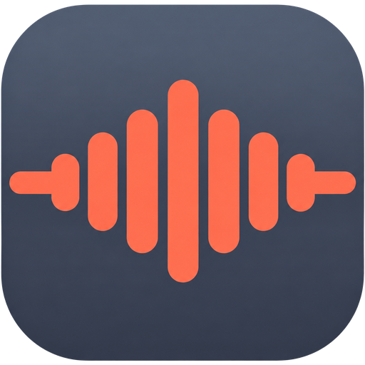
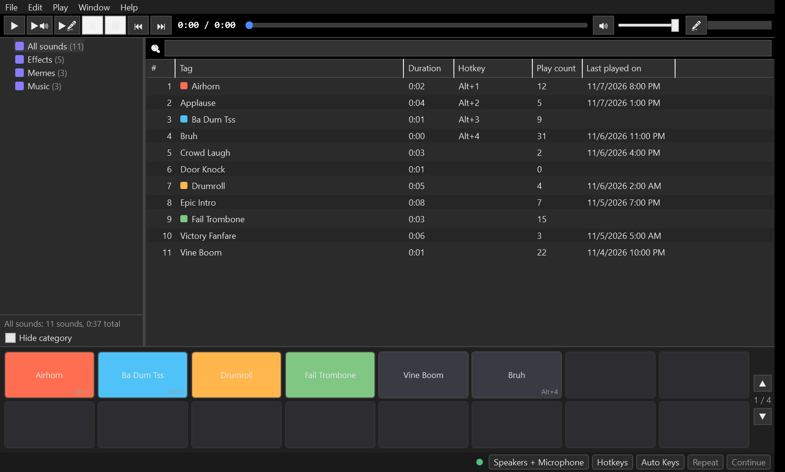

<p align="center">
  
</p>

<h1 align="center">VoxPad</h1>

<p align="center"><b>A free Windows soundboard that plays sounds through your microphone in Discord, games and streams.</b></p>

<p align="center">
  <a href="https://github.com/youngfalconstone/VoxPad/releases/latest"></a>
</p>

<p align="center">
  <a href="https://github.com/youngfalconstone/VoxPad/releases/latest"></a>
  <a href="https://github.com/youngfalconstone/VoxPad/actions/workflows/ci.yml"></a>
  <a href="LICENSE"></a>
</p>

<p align="center">
  
</p>

## Install

1. **Download** `VoxPad-<version>-win-x64.exe` from the [latest release](https://github.com/youngfalconstone/VoxPad/releases/latest). Use the `win-arm64` file on ARM PCs.
   It is a standalone app: nothing else to install, no .NET runtime needed. Prefer an installer? Grab the `.msi`. Want it on a USB stick? Use the portable `.zip`.
2. **Install [VB-CABLE](https://vb-audio.com/Cable/)** (free) and restart once. It provides the virtual microphone VoxPad plays into.
3. **Start VoxPad** and open *File > Preferences > Devices*. Status should read **Good**. Tick **Use** next to your real microphone so your voice is mixed in.
4. In Discord, your game or OBS, **select "CABLE Output" as the microphone**.
5. Drag sound files onto the window and press a hotkey or click a hotbar tile.

Windows may show a SmartScreen prompt on first launch because the exe isn't code-signed. Click *More info > Run anyway*.

## Features

- **Plays into your mic and your speakers.** Your voice and the sound are mixed, or the voice is muted while a sound plays.
- **Global hotkeys** that work over full-screen games, plus numpad and index hotkeys to play sound #N.
- **Auto Keys:** presses your push-to-talk key automatically while a sound plays.
- **Loudness matching** (EBU R128) so every sound is as loud as your voice.
- **Categories, a paged hotbar, search, colours,** play counts and last-played dates.
- **Recorder, waveform editor and text-to-speech** built in.
- **Sound lists** with autosave and daily backups. Imports Soundpad `.spl` lists.
- **Light, dark and high-contrast themes**, 21 languages, tray mode, portable mode.
- **Local remote-control API** (named pipe) for stream decks and scripts.
- MP3, WAV, OGG, Opus, FLAC, M4A/AAC and WMA.

The full list is in [`docs/reference.md`](docs/reference.md), and the [manual](https://youngfalconstone.github.io/VoxPad/manual.html) covers setup and troubleshooting.

## Privacy

VoxPad works offline and has no telemetry or accounts. It only goes online when you ask it to: *Import from web* downloads the URL you enter. Everything it saves stays on your PC:

| What | Where |
|------|-------|
| Preferences, sound list, daily list backups, play statistics, loudness cache | `%APPDATA%\VoxPad` |
| Logs and crash reports | `%ProgramData%\VoxPad` |
| Your recordings, text-to-speech files and web imports | `Music\VoxPad` |
| Temporary files (recording buffer, the diagnostics zip you create in *Help > Troubleshooting*) | `%TEMP%\VoxPad` |

Sound lists store file paths only, never the audio itself. In portable mode (a `portable.txt` file next to `VoxPad.exe`) everything goes into a `Data` folder beside the exe instead.

## Build from source

You need Windows 10/11 and the [.NET 8 SDK](https://dotnet.microsoft.com/download/dotnet/8.0).

```powershell
git clone https://github.com/youngfalconstone/VoxPad.git
cd VoxPad
dotnet build VoxPad.sln -c Release
dotnet test tests/VoxPad.Tests -c Release
.\build.ps1    # standalone exe, portable zip and MSI in artifacts\
```

Details are in [`docs/building.md`](docs/building.md).

## License

[MIT](LICENSE). VoxPad is an independent project and is not affiliated with Leppsoft or Soundpad. VB-CABLE is a separate product by VB-Audio.
